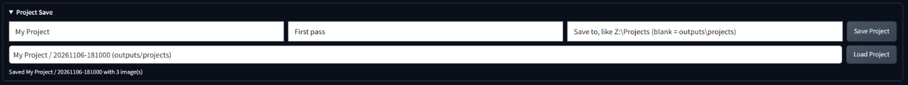

# Project Save for Stable Diffusion WebUI

A1111 forgets what's in its tabs when the page reloads or the server restarts. This extension saves a whole working setup as a named project and brings it back later.



## Install

In A1111, go to **Extensions > Install from URL**, paste this repository's URL, click **Install**, then restart A1111.

## Use

Open the collapsed **Project Save** panel at the bottom of the txt2img or img2img tab.

- **Save:** type a project name, with an optional note and an optional **Save to** folder (a full path, like `Z:\Projects`), then click **Save Project**. With no folder, it saves to `outputs/projects`.
- **Load:** pick a version from the list and click **Load Project**. The status line reports any setting that didn't come back.

Every save is a new version folder, so nothing is overwritten:

```
<folder>/<project>/<date-time>/
    project.json     all the settings
    *.png            the images in use
```

## What it saves

- Every setting on the tab, including controls added by other extensions, such as ControlNet and ADetailer
- Multi-select fields such as Styles, in the order you chose them
- The quick settings at the top of the page, such as the checkpoint and VAE
- The source image, the masks and the ControlNet images
- A mask painted on the Inpaint canvas

## Limits

- **Tested on one setup so far:** A1111 v1.10.1 on Windows with ControlNet and ADetailer. Other versions and extensions may behave differently, so check the status line after loading.
- **Painted masks** come back through **Inpaint upload**, not on the canvas, so you can't keep painting on a restored mask.
- **Controls may change:** a save made before you add or remove extensions may not restore every setting. The status line lists any that didn't.
- **Generated results** aren't saved, since A1111 already writes those to disk.
- **The page clears on reload,** so save before you reload or restart.
- **Local use only:** it adds routes to A1111's server that write to the folders you choose and read from the folders you've used. Don't use it on a WebUI shared with people you don't trust.

## License

MIT
